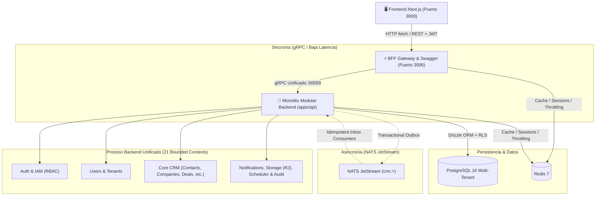

# 🏢 Enterprise CRM Platform — Modular Monolith Suite

> **Plataforma Integral de CRM Multi-Tenant de Alto Rendimiento** construida bajo la arquitectura de **Monolito Modular (DDD + Clean Architecture + Hexagonal + SOLID)**, comunicación híbrida síncrona/asíncrona (**gRPC + NATS JetStream**), aislamiento multi-inquilino de grado bancario (**PostgreSQL 16 Row-Level Security**) y frontend moderno (**Next.js 16 + React 19 + Tailwind CSS**).

---

## 🏛️ Arquitectura del Sistema

El sistema implementa un **Monolito Modular preparado para fisión a microservicios**:
- **Backend Unificado (`apps/api`):** Aloja los **21 Bounded Contexts** de la plataforma en un único proceso optimizado en Node.js, exponiendo un servidor gRPC unificado en el puerto `50059` y HTTP en el `3005`.
- **API Gateway BFF (`apps/bff`):** Actúa como puerta de enlace para el Frontend, exponiendo endpoints REST y documentación OpenAPI/Swagger en el puerto `3006`, y comunicándose con el Monolito Modular vía gRPC.
- **Frontend (`frontend`):** Aplicación SPA/SSR en Next.js 16 con React 19 (puerto `3000`), consumiendo la API REST del BFF mediante HTTP `fetch`.
- **Eventos Asíncronos:** Comunicación reactiva e integrable mediante **NATS JetStream** y el **Transactional Outbox Pattern**.



---

## 📊 Mapeo de Puertos y Servicios

| Componente | Servicio | Tipo | Puerto | Descripción |
|---|---|---|:---:|---|
| **`frontend`** | Next.js 16 | HTTP | `3000` | Interfaz de usuario web moderna |
| **`apps/bff`** | BFF Gateway | HTTP / REST | `3006` | API Gateway REST y Swagger UI (`/api/docs`) |
| **`apps/api`** | Monolito Modular | HTTP | `3005` | Core API HTTP / Health checks |
| **`apps/api`** | Monolito Modular | gRPC | `50059` | Servidor gRPC que aloja los 22 contratos |
| **Infraestructura** | PostgreSQL 16 | TCP | `5432` / `6432` | Base de datos relacional con RLS |
| **Infraestructura** | Redis 7 | TCP | `6379` | Caché, rate limiting y sesiones |
| **Infraestructura** | NATS JetStream | TCP | `4222` / `8222` | Broker de eventos y streaming |
| **Infraestructura** | MailHog | Web / SMTP | `8025` / `1025` | Servidor de correo para pruebas |

---

## 🚀 Guía de Inicio Rápido

### Opción A: Levantar Todo con Docker (Recomendado)
```bash
# 1. Configurar variables de entorno
cp .env.example .env

# 2. Levantar el stack completo (Postgres, Redis, NATS, API, BFF, Frontend)
make docker-up

# 3. Aplicar migraciones y datos demo
make db-up
```

### Opción B: Desarrollo Local
```bash
# 1. Instalar dependencias del monorepo
pnpm install

# 2. Levantar servicios de infraestructura (Postgres, Redis, NATS)
make docker-dev-up

# 3. Aplicar migraciones y seeders
make db-up

# 4. Iniciar el Monolito Modular y BFF en modo watch
pnpm dev

# 5. En otra terminal, iniciar el Frontend Next.js
cd frontend && pnpm dev
```

---

## 🔑 Credenciales de Prueba (Demo Seed)
Para acceder a la plataforma tras ejecutar `make db-seed`:
* **Tenant ID:** `00000000-0000-0000-0000-000000000001`
* **Admin:** `admin@example.com` / `seedpassword123`
* **Manager:** `manager@example.com` / `seedpassword123`
* **Agent:** `employee@example.com` / `seedpassword123`

---

## 🛠️ Comandos Útiles del Makefile
* `make dev` — Inicia los servicios de desarrollo mediante Turborepo.
* `make build` — Compila todo el workspace.
* `make typecheck` — Valida tipos de TypeScript en modo estricto.
* `make db-up` — Ejecuta migraciones de base de datos y aplica los seeders.
* `make db-reset` — Limpia y reconstruye la base de datos desde cero.
* `make db-studio` — Abre Drizzle Studio para explorar las tablas visualmente.
