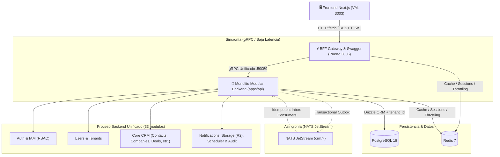

# 🏢 Enterprise CRM Platform — Modular Monolith Suite

> **Plataforma CRM multi-tenant** construida con una arquitectura objetivo de **Monolito Modular (DDD + Clean Architecture + Hexagonal + SOLID)**, comunicación híbrida (**gRPC + NATS JetStream**), esquemas PostgreSQL y frontend moderno (**Next.js 16 + React 19 + Tailwind CSS**). La seguridad del aislamiento y el rendimiento requieren validación independiente.

> **Estado de esta documentación:** el repositorio contiene 33 módulos de API, 34 archivos Protobuf (incluido `common.proto`) y 99 archivos `page.tsx`. Esos inventarios describen código fuente; no certifican que todas las funciones estén completas o desplegadas. Los puertos indicados son valores por defecto configurables.

---

## 🏛️ Arquitectura del Sistema

El sistema implementa un **Monolito Modular preparado para fisión a microservicios**:
- **Backend Unificado (`apps/api`):** Aloja los **33 módulos** de la plataforma en un único proceso Node.js, exponiendo un servidor gRPC unificado por defecto en el puerto `50059` y HTTP en el `3005`.
- **API Gateway BFF (`apps/bff`):** Actúa como puerta de enlace para el Frontend, exponiendo endpoints REST y documentación OpenAPI/Swagger en el puerto `3006`, y comunicándose con el Monolito Modular vía gRPC.
- **Frontend (`frontend`):** Aplicación SPA/SSR en Next.js 16 con React 19 (puerto local `3000`; producción en VM `3003`), consumiendo la API REST del BFF mediante HTTP `fetch`.
- **Eventos Asíncronos:** Comunicación reactiva e integrable mediante **NATS JetStream** y el **Transactional Outbox Pattern**.



---

## 📊 Mapeo de Puertos y Servicios

| Componente | Servicio | Tipo | Puerto | Descripción |
|---|---|---|:---:|---|
| **`frontend`** | Next.js 16 | HTTP | `3000` local / `3003` VM | Interfaz de usuario web moderna |
| **`apps/bff`** | BFF Gateway | HTTP / REST | `3006` | API Gateway REST y Swagger UI (`/api/docs`) |
| **`apps/api`** | Monolito Modular | HTTP | `3005` | Core API HTTP / Health checks |
| **`apps/api`** | Monolito Modular | gRPC | `50059` | Servidor gRPC que carga los contratos Protobuf del repositorio |
| **Infraestructura** | PostgreSQL 16 | TCP | `5432` | Puerto publicado por los compose locales; RLS debe verificarse por tabla/política |
| **Infraestructura** | Redis 7 | TCP | `6379` | Caché, rate limiting y sesiones |
| **Infraestructura** | NATS JetStream | TCP | `4222` / `8222` | Broker de eventos y streaming |
| **Infraestructura** | MailHog | Web / SMTP | `8025` / `1025` | Servidor de correo para pruebas |

---

## 🚀 Guía de Inicio Rápido

### Opción A: Levantar la infraestructura con Docker
```bash
# 1. Configurar variables de entorno
cp .env.example .env

# 2. Levantar la infraestructura local (PostgreSQL, Redis, NATS y MailHog)
make docker-up

# Para desplegarlos en VMs separadas, copia a cada una su carpeta compose/<servicio>
# y ejecuta allí: docker compose up -d

# 3. Aplicar migraciones y datos demo (con las dependencias configuradas)
make db-up

# 4. Iniciar API y BFF; en otra terminal, iniciar el frontend
pnpm dev
# cd frontend && pnpm dev
```

### Opción B: Desarrollo Local
```bash
# 1. Instalar dependencias del monorepo
pnpm install

# 2. Levantar servicios de infraestructura (PostgreSQL, Redis, NATS y MailHog)
docker compose -f docker-compose.dev.yml up -d

# 3. Aplicar migraciones y seeders
make db-up

# 4. Iniciar el Monolito Modular y BFF en modo watch
pnpm dev

# 5. En otra terminal, iniciar el Frontend Next.js
cd frontend && pnpm dev
```

---

## Despliegue CI/CD

- GitHub Actions valida los cambios en pull requests y pushes a `main`, `master` o `develop`. Despliega producción después de un push a `main` con validaciones aprobadas, o manualmente desde `main`.
- El job de despliegue conecta el runner a Tailscale, compila el workspace en GitHub Actions, sincroniza el workspace compilado con la VM de aplicación, instala allí dependencias de producción y recarga PM2. La compilación no se ejecuta en la VM.
- `deploy-vm.sh` sincroniza únicamente el `.env` local con la VM por Tailscale y lo instala con permisos `600`; no compila, copia código ni reinicia servicios. Para publicar cambios de código o reiniciar procesos, usa el workflow de GitHub Actions.
- En el entorno `production` de GitHub configura los secretos `TS_OAUTH_CLIENT_ID`, `TS_OAUTH_SECRET` y `DEPLOY_SSH_KEY` (clave SSH dedicada), más las variables `DEPLOY_HOST` (IP Tailscale de la VM, actualmente `100.64.183.123`) y `DEPLOY_KNOWN_HOSTS` (clave de host SSH verificada). La política de Tailscale debe permitir a `tag:ci` llegar por SSH a esa VM; la clave SSH debe estar autorizada en la cuenta `ubuntu`.

No agregues `.env` ni claves privadas al repositorio. Los valores de aplicación permanecen en la VM.

---

## 🔑 Credenciales de Prueba (Demo Seed)
Para acceder a la plataforma tras ejecutar `make db-seed`, el seed actual (`packages/database/src/seed/seed.ts`) crea usuarios demo con la contraseña `Password123!`:
* **Tenant ID:** `00000000-0000-0000-0000-000000000001`
* **Admin:** `admin@nexoracrm.com` o `demo@nexoracrm.com`
* **Manager:** `sarah.connor@nexoracrm.com`
* **Agentes:** `alex.mercer@nexoracrm.com`, `elena.rostova@nexoracrm.com`

Son credenciales de desarrollo únicamente. Cámbialas y no las uses en producción.

---

## 🛠️ Comandos Útiles del Makefile
* `make dev` — Inicia los servicios de desarrollo mediante Turborepo.
* `make build` — Compila todo el workspace.
* `make typecheck` — Valida tipos de TypeScript en modo estricto.
* `make db-up` — Ejecuta migraciones de base de datos y aplica los seeders.
* `make db-reset` — Limpia y reconstruye la base de datos desde cero.
* `make db-studio` — Abre Drizzle Studio para explorar las tablas visualmente.
