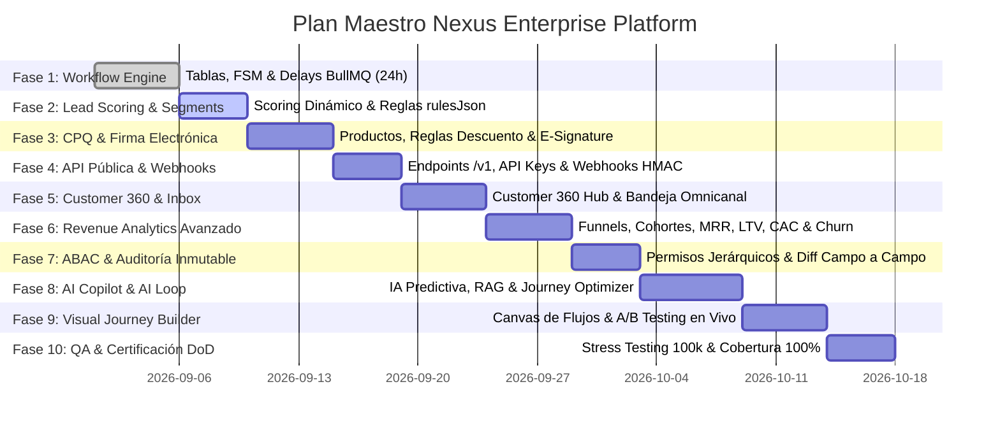

# 🌐 Nexus CRM — Master Roadmap: Customer Engagement, CPQ & Revenue Automation Platform

Este documento define la arquitectura integral, modelo de datos y plan de ejecución por fases para consolidar Nexus CRM como una **Plataforma Integral de Automatización de Ingresos, CPQ, E-Signature, API Pública y Analítica Avanzada (Revenue & Customer Engagement Platform)**.

---

## 🏛️ 1. Arquitectura General del Ecosistema

```text
                                         NEXUS ENTERPRISE PLATFORM
                                                     │
 ┌───────────────────┬───────────────────┬───────────┴───────────┬───────────────────┬───────────────────┐
 │                   │                   │                       │                   │                   │
CRM CORE        AUTOMATION          CPQ & DOCUMENTS         INTELLIGENCE        COMMUNICATIONS      DEVELOPER & DATA
 │                   │                   │                       │                   │                   │
 ├─ Contacts         ├─ Workflows (v1/v2)├─ Product Catalog      ├─ Lead Scoring     ├─ Omnichannel Inbox├─ Public API (/v1)
 ├─ Companies        ├─ Triggers en NATS ├─ Discount Approvals   ├─ Sales Forecasting├─ WhatsApp (Meta)  ├─ Webhooks (HMAC)
 ├─ Deals            ├─ Delays en BullMQ ├─ Dynamic Quotes       ├─ AI Copilot (LLM) ├─ Email (SMTP/IMAP)├─ Funnels & Cohorts
 ├─ Pipelines        ├─ A/B Split Testing├─ PDF Generator        ├─ Intent Detection ├─ SMS / Calls      ├─ SaaS MRR/ARR/LTV
 └─ Tickets & SLA    └─ Journey Builder  └─ E-Signature (Firma)  └─ Churn Risk Model └─ Customer 360 Hub └─ RBAC + ABAC + Audit
```

---

## 📊 2. Plan Maestro de Implementación por Fases



---

### 🔹 FASE 1: Motor de Automatizaciones & Runtime de Workflows (Workflow Engine)
**Objetivo:** Runtime distribuido con versionado inmutable, soporte de delays sin bloqueo y claves de idempotencia.

- [ ] **1.1 Persistencia y Versionado Inmutable:**
  - Tablas: `workflow_definitions` (v1, v2...), `workflow_executions`, `workflow_step_executions`.
  - Estados: `RUNNING`, `WAITING_DELAY`, `COMPLETED`, `CANCELLED`, `FAILED`.
  - Clave de idempotencia única: `${executionId}_${stepId}_${attempt}`.
- [ ] **1.2 Cola de Tareas Diferidas (BullMQ + Redis):**
  - Manejo de esperas (`delay: "10m"`, `delay: "24h"`, `delay: "30d"`) en segundo plano sin bloquear hilos.
  - Reintentos con retroceso exponencial (`exponential backoff`) y Dead Letter Queue (DLQ).
- [ ] **1.3 Consumidor de Eventos NATS JetStream:**
  - Suscripción reactiva a `crm.*.*` (`crm.contact.created`, `crm.deal.stage_changed`, `crm.ticket.created`).
  - Cancelación reactiva automática de flujos activos ante eventos de negocio contrarios.

---

### 🔹 FASE 2: Lead Scoring Dinámico & Segmentación Reactiva
**Objetivo:** Puntuación en tiempo real del interés y propensión de compra del prospecto.

- [ ] **2.1 Motor de Reglas de Scoring (`rulesJson`):**
  - Demografía (+10 C-Level, +15 empresa >50 empleados) + Comportamiento (+25 pide cotización, +20 abre email, +15 responde WhatsApp, +30 visita pricing).
  - Factor de decaimiento (*Score Decay*): -5 puntos cada 7 días sin actividad.
- [ ] **2.2 Clasificación de Temperatura:**
  - `COLD` (<40 pts), `WARM` (40-79 pts), `HOT` (≥80 pts).
  - Emisión de eventos: `crm.lead.temperature_changed` y `crm.lead.score_threshold_reached`.
- [ ] **2.3 Segmentos Dinámicos Multi-Criterio:**
  - Evaluación reactiva en cada mutación de datos (`Country == 'Colombia' AND Revenue > 10M AND LeadScore >= 80`).

---

### 🔹 FASE 3: Catálogo de Productos, CPQ (Configure, Price, Quote) & Firma Electrónica
**Objetivo:** Flujo comercial avanzado desde la selección de productos y control de márgenes hasta la firma digital del contrato.

```text
Lead ➔ Opportunity ➔ Quote (CPQ) ➔ Discount Rule (>20%?) ➔ Manager Approval ➔ E-Signature ➔ Deal WON ➔ Automation
```

- [ ] **3.1 Catálogo de Productos y Listas de Precios:**
  - Tablas: `products`, `price_books`, `quote_line_items`.
  - Soporte para precios por volumen, modelos de suscripción recurrente (MRR) y pago único.
- [ ] **3.2 Motor de Reglas de Descuento y Aprobaciones (CPQ Approvals):**
  - Si `Discount > 20%` ➔ Bloquea envío de cotización y genera tarea de aprobación para el `Sales Manager`.
  - Notificación inmediata al gerente vía WhatsApp/Email para aprobar con un clic.
- [ ] **3.3 Generador de Documentos Dinámicos en PDF:**
  - Plantillas HTML con variables contextuales: `{{customer.name}}`, `{{company.tax_id}}`, `{{deal.amount}}`, `{{line_items_table}}`.
  - Generación de PDFs protegidos con marcas de agua y numeración oficial correlativa.
- [ ] **3.4 Módulo de Firma Electrónica (E-Signature):**
  - Envío de enlace seguro de firma al cliente con verificación OTP (Email/SMS).
  - Captura de traza de auditoría: IP del firmante, timestamp UTC, User-Agent y Hash SHA-256 del documento.
  - **Efecto Domino:** Documento firmado ➔ `crm.contract.signed` ➔ Deal marcado automáticamente como `WON` ➔ Disparo de flujo de onboarding en Automation Engine.

---

### 🔹 FASE 4: API Pública Versionada (`/api/v1/*`) & Webhooks Salientes con HMAC
**Objetivo:** Permitir a desarrolladores y plataformas externas integrar Nexus CRM de forma estándar, segura y escalable.

- [ ] **4.1 API REST Pública Versionada:**
  - `POST /api/v1/contacts` / `GET /api/v1/contacts/:id`
  - `POST /api/v1/deals` / `PATCH /api/v1/deals/:id`
  - `POST /api/v1/tickets` / `GET /api/v1/quotes/:id`
  - Autenticación mediante API Keys (`Bearer nex_live_...`) con permisos granulares (read/write por módulo) y Rate Limiting en Redis (ej. 100 req/min).
- [ ] **4.2 Motor de Webhooks Salientes (Outbound Webhooks):**
  - Eventos despachables: `contact.created`, `deal.stage_changed`, `deal.won`, `quote.accepted`, `contract.signed`, `ticket.created`, `payment.received`.
  - Firma criptográfica en encabezado: `X-Nexus-Signature: sha256=...` (calculada con HMAC del payload y secret del cliente).
  - Cola de reintentos con backoff exponencial y panel de auditoría de entregas (`200 OK`, `500 Server Error`, tiempos de respuesta).

---

### 🔹 FASE 5: Vista Unificada Customer 360 & Omnichannel Inbox
**Objetivo:** Consolidar en una sola pantalla el perfil comercial, financiero, soporte y comunicaciones.

- [ ] **5.1 Vista Customer 360 (`/contacts/[id]/360`):**
  - Métricas financieras (LTV, MRR, Pipeline activo, Puntos de Lealtad).
  - Timeline cronológico interactivo unificando Emails, WhatsApps, llamadas, cotizaciones, tickets y contratos.
- [ ] **5.2 Bandeja Omnicanal (Omnichannel Inbox - `/inbox`):**
  - Bandeja unificada con canales segregados (Email, WhatsApp Meta API, SMS, WebChat).
  - Vinculación instantánea del chat al contacto y oportunidad comercial (`dealId`).

---

### 🔹 FASE 6: Analítica Avanzada de Ingresos (Revenue, Funnels & Cohorts)
**Objetivo:** Inteligencia de negocio para la toma de decisiones basada en métricas financieras y retención.

```text
FUNNEL DE CONVERSIÓN                  ANÁLISIS DE COHORTES (RETENCIÓN)
10.000 Leads                           Cohorte Enero (100 clientes)
  ↓ 35%                                  ├── Mes 1: 95% retención ($950k)
3.500 Contactados                        ├── Mes 2: 91% retención ($910k)
  ↓ 40%                                  ├── Mes 3: 88% retención ($880k)
1.400 Oportunidades                      └── Mes 4: 92% (+Expansión $920k)
  ↓ 25%
  350 Clientes Ganados (Win Rate: 25%)
```

- [ ] **6.1 Tablero de Métricas SaaS & B2B Revenue:**
  - **MRR / ARR:** Ingresos recurrentes mensuales y anuales desglosados en:
    - *New MRR* (Nuevos clientes).
    - *Expansion MRR* (Upgrades / cross-sells).
    - *Contraction MRR* (Downgrades).
    - *Churned MRR* (Cancelaciones).
  - **LTV / CAC:** Relación de Lifetime Value vs. Costo de Adquisición de Cliente.
  - **Sales Velocity:** Fórmula $\text{Velocidad} = \frac{\text{Deals} \times \text{Win Rate} \times \text{Ticket Promedio}}{\text{Duración del Ciclo de Venta en Días}}$.
- [ ] **6.2 Funnels de Conversión con Tasa de Abandono (Drop-off):**
  - Visualización gráfica de cada fase del embudo y porcentaje de pérdida entre etapas.
- [ ] **6.3 Análisis de Cohortes:**
  - Matriz de retención y valor de vida de clientes agrupados por mes de adquisición.

---

### 🔹 FASE 7: Gobernanza Empresarial (RBAC + ABAC Jerárquico & Audit Log Inmutable)
**Objetivo:** Control de acceso granular por atributos organizacionales y trazabilidad forense.

- [ ] **7.1 Control de Acceso ABAC (Attribute-Based Access Control):**
  - Vendedor ve solo sus clientes; Gerente ve clientes de su equipo y región (`Region == 'Colombia' AND Department == 'Sales'`); Admin ve toda la empresa.
- [ ] **7.2 Auditoría Inmutable con Diff Campo a Campo:**
  - Registro de: `ActorId`, `Action`, `Entity`, `Timestamp`, `IP`, `UserAgent` y `Diff JSON` (`{ amount: { from: 10M, to: 15M } }`).

---

### 🔹 FASE 8: AI Copilot & Bucle de Automatización Inteligente (AI + Automation)
**Objetivo:** Asistente conversacional de ingresos y optimización proactiva de oportunidades.

- [ ] **8.1 Asistente Conversacional AI Copilot (`/copilot`):**
  - Consultas en lenguaje natural: *"¿Qué 5 leads debería contactar hoy antes de mediodía?"*, *"¿Por qué cayó el win rate de renovaciones este mes?"*.
  - Resúmenes automáticos de cuentas de clientes antes de videollamadas.
- [ ] **8.2 Detección de Intención & Asignación Autónoma de Flujos:**
  - Detección de intención en emails/chats entrantes y asignación del journey óptimo de cierre.
  - Alerta de riesgo de Churn en contratos antes de su vencimiento.

---

### 🔹 FASE 9: Visual Journey Builder & A/B Split Testing
**Objetivo:** Diseñador gráfico de flujos interactivos con ramificaciones y experimentos en vivo.

- [ ] **9.1 Constructor Visual de Flujos (Canvas Interactivo):**
  - Nodos conectables: `Trigger`, `Action`, `Delay`, `Condition`, `A/B Split`, `End`.
- [ ] **9.2 Experimentos A/B Split Testing:**
  - Distribución de tráfico 50/50 entre plantillas de mensaje y medición de tasa de respuesta y ventas ganadas.

---

### 🔹 FASE 10: Pruebas de Carga, Stress Testing & Certificación DoD
**Objetivo:** Garantizar rendimiento óptimo bajo alta concurrencia y 100% de fiabilidad transaccional.

- [ ] **10.1 Tests Unitarios & Integración (100% Cobertura):**
  - CPQ, reglas de descuento, firma digital, webhooks HMAC y analítica de cohortes.
- [ ] **10.2 Stress Testing con 100.000 Eventos Concurrentes:**
  - Validación de cero duplicados con claves de idempotencia en BullMQ y NATS.
- [ ] **10.3 Tests E2E de Ciclo Completo:**
  - Lead ➔ Score 92 ➔ Quote CPQ ➔ Aprobación Descuento ➔ Firma E-Sign ➔ Webhook disparado ➔ Deal WON ➔ Métricas MRR actualizadas.

---

## 📌 Matriz de Paquetes y Responsabilidades

| Bounded Context | Paquete / Directorio | Responsabilidad Principal |
|---|---|---|
| `CrmCore` | `apps/api/src/modules/{contacts,companies,deals,tickets}` | Gestión de entidades centrales de negocio y multi-tenancy RLS. |
| `AutomationModule` | `apps/api/src/modules/automation/` | Runtime de workflows, FSM, listeners NATS y BullMQ Workers. |
| `CpqDocumentsModule` | `apps/api/src/modules/contracts/` & `storage/` | Catálogo de productos, reglas de descuento, PDF y E-Signature. |
| `DeveloperApiModule` | `apps/bff/src/modules/developer-api/` | Endpoints REST públicos `/api/v1/*`, API Keys y Webhooks HMAC. |
| `AnalyticsModule` | `apps/api/src/modules/sales-teams/` & `audit/` | Funnels, cohortes de retención, MRR/ARR/LTV y Sales Velocity. |
| `IntelligenceModule` | `apps/api/src/modules/intelligence/` | Lead Scoring dinámico, AI Copilot y predicción de intención. |
| `OmnichannelModule` | `apps/api/src/modules/helpdesk/` | Bandeja unificada y conectores multicanal (Email, WhatsApp, SMS). |
| `AutomationsUI` | `frontend/app/(crm)/automations/` | Visual Journey Builder, monitor de ejecuciones y A/B tests. |
| `Customer360UI` | `frontend/app/(crm)/contacts/[id]/360/` | Vista holística del cliente con timeline consolidado. |
| `AnalyticsUI` | `frontend/app/(crm)/analytics/` | Dashboards de ingresos SaaS, funnels y retención por cohortes. |
