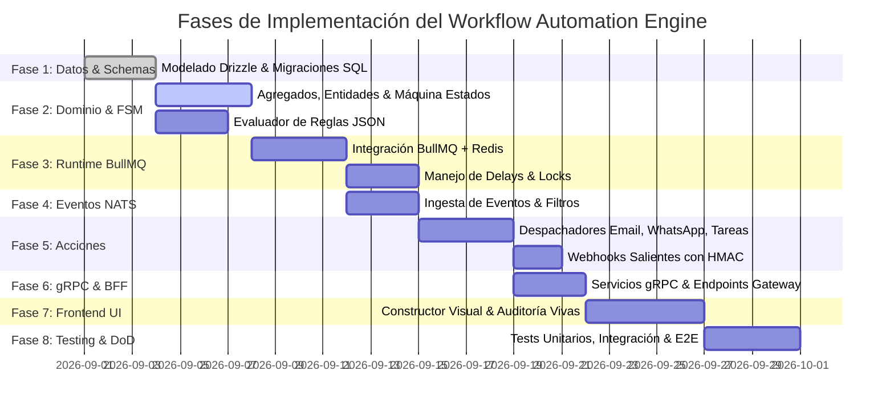

# 🚀 Nexora CRM — Roadmap de Implementación: Workflow Automation Engine

Este documento define la arquitectura, diseño técnico y plan por fases para implementar el **Motor de Automatizaciones y Workflows Distribuidos** de Nexora CRM, elevando la plataforma al nivel de soluciones líderes (HubSpot Workflows, ActiveCampaign) bajo arquitectura limpia (DDD, Hexagonal, SOLID y Modular Monolith).

---

## 🏛️ 1. Arquitectura de Referencia

```text
                  NEXORA CRM BUSINESS CORE
         (Contacts, Deals, Tickets, Quotes, Campaigns)
                             │
                             ▼ (Domain Events)
                     📦 Transactional Outbox
                             │
                             ▼
                    ⚡ NATS JetStream
                Topic: crm.<aggregate>.<event>
                             │
                             ▼
               ⚙️ AUTOMATION ENGINE CONSUMER
                             │
               ┌─────────────┴─────────────┐
               │                           │
               ▼                           ▼
      💾 PostgreSQL (RLS)           🔴 Redis + BullMQ
  • workflow_definitions (v1, v2)   • Delayed Jobs (24h, 10m)
  • workflow_executions             • Retry Policies & Backoff
  • workflow_step_executions        • Distributed Locks
               │                           │
               └─────────────┬─────────────┘
                             ▼
                    🛠️ WORKFLOW WORKERS
        ┌────────────────────┼────────────────────┐
        ▼                    ▼                    ▼
   📱 WhatsApp           ✉️ Email             📋 Tasks / CRM
 (Meta API / Twilio) (SMTP / SendGrid)     (Internal Mutations)
```

---

## 📅 2. Plan de Implementación por Fases



---

### 🔹 FASE 1: Modelado de Datos y Persistencia Transaccional
**Objetivo:** Crear la estructura de almacenamiento con versionado inmutable, soporte multi-tenant (RLS) y claves únicas de idempotencia.

- [ ] **1.1 Tabla `workflow_definitions`:**
  - `id`: UUID (Primary Key).
  - `tenant_id`: UUID (Foreign Key `tenants.id`, indexado con RLS).
  - `name`: `varchar(200)`.
  - `description`: `text` nullable.
  - `version`: `integer NOT NULL DEFAULT 1`.
  - `status`: `enum('DRAFT', 'ACTIVE', 'PAUSED', 'ARCHIVED')`.
  - `trigger_event`: `varchar(150)` (ej. `crm.contact.created`, `crm.deal.stage_changed`).
  - `trigger_filter`: `jsonb` (condiciones para que el trigger active el flujo).
  - `steps_graph`: `jsonb` (árbol con nodos de tipo `ACTION`, `DELAY`, `CONDITION`, `BRANCH`).
  - `created_at`, `updated_at`.
  - **Restricción:** Clave única `(tenant_id, name, version)`.

- [ ] **1.2 Tabla `workflow_executions`:**
  - `id`: UUID (Primary Key).
  - `tenant_id`: UUID (RLS).
  - `workflow_id`: UUID (Foreign Key `workflow_definitions.id`).
  - `version`: `integer` (versión congelada con la que inició el registro).
  - `entity_type`: `varchar(50)` (`contact`, `deal`, `ticket`, `quote`).
  - `entity_id`: UUID (ID del contacto, oportunidad o ticket asociado).
  - `status`: `enum('RUNNING', 'WAITING_DELAY', 'COMPLETED', 'CANCELLED', 'FAILED')`.
  - `current_step_id`: `varchar(100)` (identificador del nodo actual en el grafo).
  - `context_data`: `jsonb` (estado acumulado y variables recogidas en la ejecución).
  - `started_at`, `completed_at`, `cancelled_at`, `error_message`.
  - **Índices:** `(tenant_id, status)`, `(entity_type, entity_id)`.

- [ ] **1.3 Tabla `workflow_step_executions` (Historial & Idempotencia):**
  - `id`: UUID (Primary Key).
  - `tenant_id`: UUID (RLS).
  - `execution_id`: UUID (Foreign Key `workflow_executions.id` ON DELETE CASCADE).
  - `step_id`: `varchar(100)`.
  - `idempotency_key`: `varchar(255) NOT NULL UNIQUE` (formato: `${executionId}_${stepId}_${attempt}`).
  - `status`: `enum('PENDING', 'EXECUTING', 'SUCCESS', 'FAILED', 'SKIPPED')`.
  - `attempts`: `integer DEFAULT 1`.
  - `output_data`: `jsonb` (respuestas de APIs externas o resultados).
  - `error_message`: `text`.
  - `started_at`, `completed_at`.

---

### 🔹 FASE 2: Capa de Dominio y Máquina de Estados Finita (FSM)
**Objetivo:** Modelar la lógica pura de negocio sin acoplamientos a frameworks ni ORMs.

- [ ] **2.1 Agregado `WorkflowDefinition`:**
  - Invariante: Una versión en estado `ACTIVE` no puede modificarse; cualquier edición crea una nueva versión (`cloneAsNewVersion()`).
  - Validación del grafo de pasos (detección de ciclos infinitos, pasos huérfanos o ramas sin salida).
- [ ] **2.2 Agregado `WorkflowExecution`:**
  - Transiciones de estado válidas: `RUNNING` ➔ `WAITING_DELAY` ➔ `RUNNING` ➔ `COMPLETED` / `CANCELLED` / `FAILED`.
  - Métodos de dominio: `advanceToNextStep(outputData)`, `waitForDelay(stepId, duration)`, `cancel(reason)`, `recordFailure(error)`.
- [ ] **2.3 Motor de Evaluación de Reglas (`ConditionEvaluator`):**
  - Evaluación de operadores lógicos: `EQUALS`, `NOT_EQUALS`, `GREATER_THAN`, `LESS_THAN`, `CONTAINS`, `IN`, `IS_EMPTY`.
  - Soporte de expresiones compuestas (`AND` / `OR` anidados) sobre variables de contexto.

---

### 🔹 FASE 3: Runtime Asíncrono con BullMQ y Redis
**Objetivo:** Ejecutar tareas en segundo plano, gestionar delays prolongados sin bloquear Node.js y garantizar reintentos exponenciales.

- [ ] **3.1 Configuración de Colas BullMQ:**
  - `workflow-trigger-queue`: Ingesta inicial de eventos disparadores.
  - `workflow-step-queue`: Ejecución de pasos inmediatos o diferidos.
- [ ] **3.2 Manejo de Delays (Atrasos en el tiempo):**
  - Al llegar a un nodo `DELAY (duration: "24h")`:
    - Se registra el estado `WAITING_DELAY` en Postgres.
    - Se encola el job en BullMQ con `delay: 86400000` (24h).
    - El hilo de Node.js queda libre inmediatamente.
- [ ] **3.3 Locks Distribuidos (`Redlock`):**
  - Garantizar que una misma ejecución (`execution_id`) no sea procesada concurrentemente por dos workers si llegan eventos simultáneos.
- [ ] **3.4 Políticas de Reintento y Dead Letter Queue (DLQ):**
  - Estrategia de reintento: 3 intentos con retroceso exponencial (`backoff: { type: 'exponential', delay: 5000 }`).
  - Fallos irrecuperables se envían a cola de dead-letter con alerta de auditoría.

---

### 🔹 FASE 4: Ingesta de Eventos de Dominio vía NATS JetStream
**Objetivo:** Conectar el Outbox Pattern con el Automation Engine de manera reactiva.

- [ ] **4.1 Consumidores NATS JetStream:**
  - Suscripción a temas `crm.*.*` (`crm.contact.created`, `crm.deal.won`, `crm.ticket.created`, `crm.quote.accepted`).
- [ ] **4.2 Filtro de Coincidencia de Triggers:**
  - Buscar workflows activos (`status = 'ACTIVE'`) para el `tenant_id` y evento correspondiente.
  - Evaluar `trigger_filter` contra el payload del evento.
  - Instanciar `workflow_executions` de manera idempotente (usando `event_id` como clave para no duplicar flujos).

---

### 🔹 FASE 5: Despachadores de Acciones (Action Handlers)
**Objetivo:** Implementar los ejecutores de acciones externas e internas.

- [ ] **5.1 Despachador de WhatsApp y SMS:**
  - Integración de plantillas aprobadas con variables dinámicas (`{{contact.name}}`, `{{deal.amount}}`).
- [ ] **5.2 Despachador de Email:**
  - Renderizado de plantillas HTML transaccionales con soporte para seguimiento de aperturas y clics.
- [ ] **5.3 Acciones Internas del CRM:**
  - Creación automática de tareas (`TaskCreated`), asignación de vendedor (`UserAssigned`), asignación de etiquetas (`TagAssigned`) y actualización de etapas de Deals.
- [ ] **5.4 Webhooks Salientes con Firma Criptográfica:**
  - Envío de llamadas HTTP POST a APIs externas con firma HMAC SHA-256 en header (`X-Signature`).

---

### 🔹 FASE 6: Capa gRPC, Gateway BFF y Contratos Zod
**Objetivo:** Exponer la gestión de automatizaciones de forma tipada y segura para el frontend.

- [ ] **6.1 Paquete `@crm/contracts`:**
  - Schemas Zod: `WorkflowDefinitionSchema`, `CreateWorkflowSchema`, `UpdateWorkflowSchema`, `WorkflowExecutionSchema`.
- [ ] **6.2 Microservicio gRPC (`apps/api`):**
  - `AutomationService`: `CreateWorkflow`, `UpdateWorkflow`, `ListWorkflows`, `GetWorkflowExecution`, `CancelExecution`, `RetryStep`.
- [ ] **6.3 BFF Controller (`apps/bff`):**
  - Endpoints REST `/api/automations/workflows` con validación Zod y caché selectivo.

---

### 🔹 FASE 7: Experiencia de Usuario en Frontend (Next.js 16)
**Objetivo:** Interfaz visual intuitiva para crear, monitorear y depurar automatizaciones.

- [ ] **7.1 Listado de Automatizaciones (`/automations`):**
  - Tabla con estado (Activo/Borrador/Pausado), versión actual, ejecuciones activas y tasa de éxito.
- [ ] **7.2 Constructor de Workflows (`/automations/[id]/builder`):**
  - Editor visual secuencial con selector de Disparadores, Acciones, Delays y Ramas condicionales (Sí / No).
- [ ] **7.3 Monitor y Depurador de Ejecuciones (`/automations/executions/[id]`):**
  - Vista paso a paso de la ruta que siguió un cliente específico, tiempos de espera, cargas útiles de entrada/salida y botón de reintento manual en caso de error.

---

### 🔹 FASE 8: Pruebas Exhaustivas y Definition of Done (DoD)
**Objetivo:** Cobertura total y verificación de fiabilidad en condiciones reales.

- [ ] **8.1 Tests Unitarios (100% en Lógica de Dominio):**
  - Evaluación de árboles de condiciones con operadores complejos.
  - Invariantes de versionado inmutable en `WorkflowDefinition`.
  - Transiciones de estado de `WorkflowExecution`.
- [ ] **8.2 Tests de Integración:**
  - Persistencia en PostgreSQL con Drizzle y aislamiento de inquilinos con RLS.
  - Encolado de Delays en Redis + BullMQ y reanudación precisa de workers.
  - Verificación de no-duplicidad con `idempotency_key`.
- [ ] **8.3 Tests E2E:**
  - Disparo de evento `ContactCreated` ➔ Inicio de flujo ➔ Paso 1 WhatsApp ➔ Delay simulado ➔ Evaluación de condición ➔ Finalización con éxito.

---

## 📌 Resumen de Entregables por Módulo

| Módulo | Paquete / Servicio | Principales Responsabilidades |
|---|---|---|
| `@crm/database` | `packages/database` | Esquemas de tablas `workflow_*`, migraciones Drizzle y RLS. |
| `@crm/contracts` | `packages/contracts` | Schemas Zod, validaciones de grafos y DTOs tipados. |
| `AutomationModule` | `apps/api` | Lógica DDD, FSM, listeners NATS, BullMQ Workers y gRPC. |
| `AutomationsBff` | `apps/bff` | API Gateway REST, autenticación, autorización y swagger docs. |
| `AutomationsUI` | `frontend` | Constructor de flujos, monitor de auditoría y métricas. |
